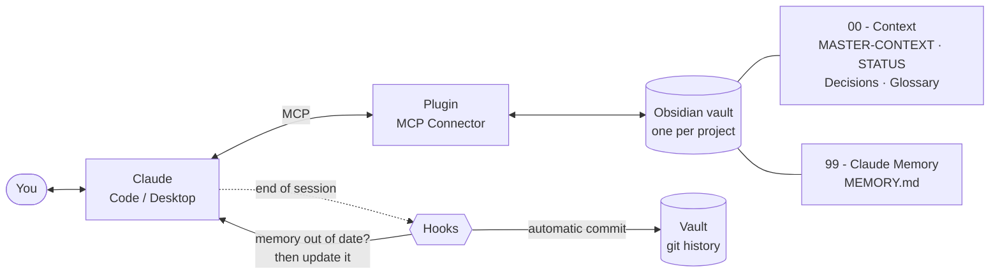

# Long-term memory for AI with Obsidian

[](https://github.com/guiboorges/memoria-ia-obsidian/releases/latest) [](LICENSE)

**How to give Claude a memory that isn't lost between conversations: one Obsidian vault per project, connected to Claude over MCP, with hooks that make the AI keep everything up to date.**

I use this system across several projects at the same time. Here is the complete method, an example vault ready to copy, and the scripts that automate the tedious part.

---

## The problem

Every conversation with an AI starts from scratch. You explain the project, the decisions, what has already been done… and the following week you explain it all again. On long projects this costs time and causes mistakes: the AI suggests an idea you already rejected, forgets a term you agreed on, redoes work.

## The solution, in one diagram



1. **One Obsidian vault per project** keeps the context in plain Markdown notes that you can also read and edit.
2. **The MCP Connector plugin** lets Claude read, search and write those notes.
3. **Anchor notes** with fixed names tell Claude what to read first: what the project is, where we are, and what has already been decided.
4. **A `CLAUDE.md`** with the rules: what to read when starting and what to update when finishing.
5. **Two hooks** at the end of every session: one doesn't let Claude finish while the memory is out of date; the other commits the vault to git, keeping the history of everything.

The result: you open a new conversation, Claude reads the memory and replies *"We're in phase X, the next step is Y, and today is the day to talk to Z"*. Without you explaining anything.

---

## The structure of a vault

```text
My Project/
├─ CLAUDE.md                  ← the rules for Claude
├─ .claude/settings.json      ← turns on the hooks (Claude Code)
├─ 00 - Context/
│  ├─ README.md               ← hub: folder index + "open items" + "work done"
│  ├─ MASTER-CONTEXT.md       ← WHAT the project is (the most important note)
│  ├─ STATUS.md               ← WHERE we are: phase, done, to do, dated reminders
│  ├─ Decisions.md            ← index of decisions
│  ├─ Decisions/ADR-0001 ….md ← WHY we decided each thing
│  ├─ Glossary.md             ← the project's terms
│  └─ Open Questions.md       ← questions that depend on someone else
├─ 01 - …/  02 - …/           ← topic folders, each with its own README (hub)
├─ 99 - Claude Memory/
│  └─ MEMORY.md               ← HOW to work: preferences and lessons, dated
└─ Templates/                 ← ADR and meeting templates
```

| Note | Answers | Who updates it |
|---|---|---|
| `MASTER-CONTEXT` | What the project is and what doesn't change | You, with Claude, rarely |
| `STATUS` | Where we are today and what's left | Claude, at the end of every session |
| `Decisions/ADR-…` | Why we did it this way | Claude, whenever there's a decision |
| `MEMORY` | How to work with me on this project | Claude, whenever it learns something |
| Each folder's `README` | What's in here and what's in progress | Claude, whenever it touches the folder |

👉 See everything filled in with an example project in [`template-vault/`](template-vault/).

---

## Step by step

### 0. What you need

- [Obsidian](https://obsidian.md) 1.7.2 or later (free)
- [Claude Code](https://claude.com/claude-code) and/or [Claude Desktop](https://claude.ai/download)
- For the hooks: `git` and `jq` (on a Mac: `brew install jq`)

### 1. Create the vault from the template

1. Download this repository (green **Code → Download ZIP** button) or clone it with `git clone`.
2. Copy the `template-vault/` folder to wherever you keep your vaults and rename it after your project. Tip: put it inside the Obsidian folder in iCloud to sync it with your phone.
3. In Obsidian, click **Open folder as vault** and choose the folder.
4. Delete the notes from the "Lumen" example, or keep them as a reference and replace them as you go.

### 2. Install the MCP Connector plugin

[MCP Connector](https://github.com/istefox/obsidian-mcp-connector) runs inside Obsidian and exposes the vault to Claude, with semantic search done on your own computer.

1. In Obsidian: **Settings → Community plugins → Browse** and search for **"MCP Connector"**. Install and enable it.
2. Open **Settings → MCP Connector → Access control**. There is a token called **"Default"**: it's the key Claude will use. **Don't share this token.**

> ⚠️ Obsidian must be **open** for Claude to access the vault, because the server runs inside it.

### 3. Connect Claude to the vault

**Claude Code:** on the token's row, click **Claude Code**. The plugin copies the full command; paste it into the Terminal. It looks like this:

```bash
claude mcp add --transport http --scope user obsidian-my-project http://127.0.0.1:27200/v1/<route-id>/mcp --header "Authorization: Bearer YOUR_TOKEN"
```

**Claude Desktop:** on the token's row, click **.mcpb** and drag the file into Claude Desktop. It shows up under **Settings → Extensions**.

**Test:** with Obsidian open, run

```bash
curl http://127.0.0.1:27200/_obsidian_mcp_broker/health
```

and then ask Claude: *"Read the vault's STATUS and tell me what phase the project is in."*

### 4. Fill in your project's memory

You don't need to write it all by hand. Open Claude and use the interview prompt (it's in [`prompts/`](prompts/README.md)):

```text
I want to create the memory for the [NAME] project. Interview me briefly, one question at a time, to fill in
00 - Context/MASTER-CONTEXT.md: who, what it is, who it's for, the goal for the next 3 months, decisions already made,
principles and what's out of scope. At the end, write the note (2 screens at most) and create STATUS.md with the current
phase and the next 3 steps.
```

### 5. Turn on the hooks (Claude Code)

The hooks are what make the system **reliable**: without them, the memory depends on you remembering to ask for an update.

```bash
mkdir -p ~/.claude/hooks
cp hooks/memory.sh hooks/git-autocommit.sh ~/.claude/hooks/
chmod +x ~/.claude/hooks/*.sh
```

The template already includes the `.claude/settings.json` that attaches both hooks to the end of every session (the `Stop` event), using the folder where you opened Claude Code:

```json
{
  "hooks": {
    "Stop": [{ "hooks": [
      { "type": "command", "command": "bash ~/.claude/hooks/memory.sh \"$CLAUDE_PROJECT_DIR\"", "timeout": 20 },
      { "type": "command", "command": "bash ~/.claude/hooks/git-autocommit.sh \"$CLAUDE_PROJECT_DIR\"", "timeout": 20 }
    ]}]
  }
}
```

Then turn the vault into a git repository (local only, no need to publish it):

```bash
cd "/path/to/your/vault" && git init && git add -A && git commit -m "initial vault"
```

**What each hook does:**

- **`memory.sh`** — at the end of the session, looks for files changed in the last 90 minutes **after** the last update to `STATUS.md` or `MEMORY.md`. If there are any, it **stops Claude from finishing** and asks it to update the memory (and the README of the folders it touched). If nothing changed, it does nothing. It has loop protection: if Claude is already continuing because of the hook, it lets it finish.
- **`git-autocommit.sh`** — commits everything that changed in the vault, with the session's date and time. You get a complete history: you can see what the AI changed and roll back any note.

> **Code outside the vault?** If the project's code lives in another folder, pass that folder as a second argument so the hook also detects when the code changed:
> `bash ~/.claude/hooks/memory.sh "/path/to/vault" "/path/to/code"`

### 6. Day-to-day use

| Moment | What happens |
|---|---|
| **Start** | Open Claude Code in the vault folder (or use the "Start a session" prompt in Desktop). Claude reads MASTER-CONTEXT → STATUS → MEMORY and tells you where we are. |
| **Work** | A new decision becomes an ADR. A pending question goes to Open Questions. A new term goes to the Glossary. |
| **Finish** | The hook checks the memory; Claude updates STATUS and MEMORY; the vault gets a commit. |

Quick commands the template's `CLAUDE.md` already understands: **`status`**, **`weekly review`** and **`wrap up`**. More ready-made prompts in [`prompts/`](prompts/README.md).

---

## Multiple projects

The method really shines when there are several projects:

- **One vault per project.** Each project has its own isolated context: Claude doesn't mix up one project's decisions with another's, and you connect only the right vault to each conversation.
- **A shared "Knowledge" vault** for whatever serves every project: design references, prompts that work, books, code patterns. Organize it with an `INDEX.md` note per area.
- **A "Routine" vault** (optional) for personal goals and reviews, with the same ideas: a weekly `STATUS` and commands like `weekly review`.

## Good practices

- **Short beats long.** `MASTER-CONTEXT` should fit in 1–2 screens. If it grows too much, split it into notes and leave links.
- **Decisions aren't reopened without a reason.** This is the rule that saves the most time: Claude stops suggesting what was already rejected.
- **Dated reminders in STATUS.** *"2026-11-03 — ask the client about X"*: Claude reminds you on the day.
- **`last_updated` at the top of every note.** Shows at a glance what's stale.
- **No secrets in the vault.** Passwords and tokens stay out of the notes; the vault goes to git and to the cloud.

## Troubleshooting

| Symptom | Cause and fix |
|---|---|
| Claude can't find the vault / `ECONNREFUSED` | Obsidian is closed. Open Obsidian with the vault. |
| `GET /mcp` returns 405 | Normal: the endpoint only accepts POST. Use the `health` test above. |
| Claude Desktop doesn't show the connector | Quit Desktop completely (**Cmd+Q**) and open it again; it only reads its configuration on startup. |
| The hook does nothing | Check that `jq` is installed and that the vault has `00 - Context/STATUS.md` and `99 - Claude Memory/MEMORY.md`. |
| The hook always asks for an update | It only looks at the last 90 minutes. To change that, set `MEMORY_MINUTES=30` in the hook command. |

## What's in this repository

```text
template-vault/   complete example vault (fictional project "Lumen", a booking app)
hooks/            memory.sh and git-autocommit.sh
prompts/          ready-made prompts for day-to-day use
```

## License

[MIT](LICENSE) © 2026 Guilherme Borges
