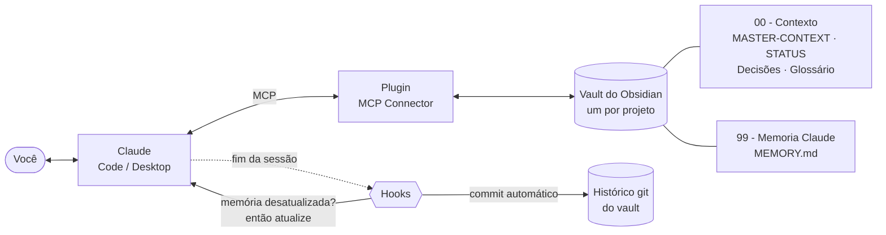

# Memória de longo prazo para IA com Obsidian

**Como dar ao Claude uma memória que não se perde entre conversas: um vault do Obsidian por projeto, ligado ao Claude por MCP, com hooks que obrigam a IA a manter tudo atualizado.**

Eu uso este sistema em vários projetos ao mesmo tempo. Aqui está o método completo, um vault de exemplo pronto para copiar e os scripts que automatizam a parte chata.

---

## O problema

Toda conversa com uma IA começa do zero. Você explica o projeto, as decisões, o que já foi feito… e na semana seguinte explica tudo de novo. Em projetos longos isso custa tempo e gera erros: a IA sugere de novo uma ideia que você já descartou, esquece um termo combinado, refaz trabalho.

## A solução, num desenho



1. **Um vault do Obsidian por projeto** guarda o contexto em notas Markdown simples, que você também lê e edita.
2. **O plugin MCP Connector** deixa o Claude ler, procurar e escrever nessas notas.
3. **Notas-âncora** com nome fixo dizem ao Claude o que ler primeiro: o que é o projeto, onde estamos e o que já foi decidido.
4. **Um `CLAUDE.md`** com as regras: o que ler ao começar e o que atualizar ao terminar.
5. **Dois hooks** no fim de cada sessão: um não deixa o Claude terminar com a memória desatualizada; o outro faz commit do vault no git, guardando o histórico de tudo.

O resultado: você abre uma conversa nova, o Claude lê a memória e responde *"Estamos na fase X, o próximo passo é Y e hoje é dia de falar com Z"*. Sem você explicar nada.

---

## A estrutura de um vault

```text
Meu Projeto/
├─ CLAUDE.md                  ← as regras para o Claude
├─ .claude/settings.json      ← liga os hooks (Claude Code)
├─ 00 - Contexto/
│  ├─ README.md               ← hub: índice da pasta + "em aberto" + "trabalho feito"
│  ├─ MASTER-CONTEXT.md       ← O QUE é o projeto (a nota mais importante)
│  ├─ STATUS.md               ← ONDE estamos: fase, feito, falta, lembretes com data
│  ├─ Decisoes.md             ← índice das decisões
│  ├─ Decisoes/ADR-0001 ….md  ← POR QUE decidimos cada coisa
│  ├─ Glossario.md            ← os termos do projeto
│  └─ Questoes em Aberto.md   ← dúvidas que dependem de alguém
├─ 01 - …/  02 - …/           ← pastas de assunto, cada uma com o seu README (hub)
├─ 99 - Memoria Claude/
│  └─ MEMORY.md               ← COMO trabalhar: preferências e lições, com data
└─ Templates/                 ← modelos de ADR e de reunião
```

| Nota | Responde a | Quem atualiza |
|---|---|---|
| `MASTER-CONTEXT` | O que é o projeto e o que não muda | Você, com o Claude, raramente |
| `STATUS` | Onde estamos hoje e o que falta | O Claude, no fim de cada sessão |
| `Decisoes/ADR-…` | Por que fizemos assim | O Claude, quando há uma decisão |
| `MEMORY` | Como trabalhar comigo neste projeto | O Claude, quando aprende algo |
| `README` de cada pasta | O que há aqui e o que está em andamento | O Claude, quando mexe na pasta |

👉 Veja tudo preenchido com um projeto de exemplo em [`template-vault/`](template-vault/).

---

## Passo a passo

### 0. O que você precisa

- [Obsidian](https://obsidian.md) 1.7.2 ou mais recente (grátis)
- [Claude Code](https://claude.com/claude-code) e/ou o [Claude Desktop](https://claude.ai/download)
- Para os hooks: `git` e `jq` (no Mac: `brew install jq`)

### 1. Crie o vault a partir do modelo

1. Baixe este repositório (botão verde **Code → Download ZIP**) ou clone com `git clone`.
2. Copie a pasta `template-vault/` para onde quer guardar os seus vaults e renomeie com o nome do seu projeto. Dica: dentro da pasta do Obsidian no iCloud, para sincronizar com o celular.
3. No Obsidian, clique em **Open folder as vault** (abrir pasta como vault) e escolha a pasta.
4. Apague as notas do exemplo "Lumen" ou use-as como referência e vá substituindo.

### 2. Instale o plugin MCP Connector

O [MCP Connector](https://github.com/istefox/obsidian-mcp-connector) roda dentro do Obsidian e expõe o vault ao Claude, com busca semântica feita no próprio computador.

1. No Obsidian: **Settings → Community plugins → Browse** (Configurações → Plugins da comunidade → Explorar) e pesquise **"MCP Connector"**. Instale e ative.
2. Abra **Settings → MCP Connector → Access control**. Há um token chamado **"Default"**: é a chave que o Claude vai usar. **Não compartilhe este token.**

> ⚠️ O Obsidian precisa estar **aberto** para o Claude acessar o vault, porque o servidor roda dentro dele.

### 3. Ligue o Claude ao vault

**Claude Code:** na linha do token, clique em **Claude Code**. O plugin copia o comando completo; cole no Terminal. Ele tem este formato:

```bash
claude mcp add --transport http --scope user obsidian-meu-projeto http://127.0.0.1:27200/v1/<route-id>/mcp --header "Authorization: Bearer SEU_TOKEN"
```

**Claude Desktop:** na linha do token, clique em **.mcpb** e arraste o arquivo para o Claude Desktop. Ele aparece em **Configurações → Extensões**.

**Teste:** com o Obsidian aberto, rode

```bash
curl http://127.0.0.1:27200/_obsidian_mcp_broker/health
```

e depois peça ao Claude: *"Leia o STATUS do vault e me diga em que fase está o projeto."*

### 4. Preencha a memória do seu projeto

Não precisa escrever tudo à mão. Abra o Claude e use o prompt de entrevista (está em [`prompts/`](prompts/README.md)):

```text
Quero criar a memória do projeto [NOME]. Faça uma entrevista curta comigo, uma pergunta de cada vez, para preencher
o 00 - Contexto/MASTER-CONTEXT.md: quem, o que é, para quem, objetivo dos próximos 3 meses, decisões já tomadas,
princípios e o que está fora do escopo. No fim, escreva a nota (máximo 2 telas) e crie o STATUS.md com a fase atual
e os próximos 3 passos.
```

### 5. Ative os hooks (Claude Code)

Os hooks são o que torna o sistema **confiável**: sem eles, a memória depende de você lembrar de pedir para atualizar.

```bash
mkdir -p ~/.claude/hooks
cp hooks/memoria.sh hooks/git-autocommit.sh ~/.claude/hooks/
chmod +x ~/.claude/hooks/*.sh
```

O modelo já traz o `.claude/settings.json` que liga os dois hooks ao fim de cada sessão (evento `Stop`), usando a pasta onde você abriu o Claude Code:

```json
{
  "hooks": {
    "Stop": [{ "hooks": [
      { "type": "command", "command": "bash ~/.claude/hooks/memoria.sh \"$CLAUDE_PROJECT_DIR\"", "timeout": 20 },
      { "type": "command", "command": "bash ~/.claude/hooks/git-autocommit.sh \"$CLAUDE_PROJECT_DIR\"", "timeout": 20 }
    ]}]
  }
}
```

E transforme o vault num repositório git (só local, não precisa publicar):

```bash
cd "/caminho/do/seu/vault" && git init && git add -A && git commit -m "vault inicial"
```

**O que cada hook faz:**

- **`memoria.sh`** — no fim da sessão, procura arquivos alterados nos últimos 90 minutos **depois** da última atualização do `STATUS.md` ou do `MEMORY.md`. Se houver, **impede o Claude de terminar** e pede que atualize a memória (e o README das pastas onde mexeu). Se nada mudou, não faz nada. Tem proteção contra ciclos: se o Claude já está continuando por causa do hook, deixa terminar.
- **`git-autocommit.sh`** — faz um commit de tudo o que mudou no vault, com a data e hora da sessão. Você ganha um histórico completo: dá para ver o que a IA mudou e voltar atrás em qualquer nota.

> **Código fora do vault?** Se o código do projeto está em outra pasta, passe essa pasta como segundo argumento, para o hook também detectar quando o código mudou:
> `bash ~/.claude/hooks/memoria.sh "/caminho/do/vault" "/caminho/do/codigo"`

### 6. Use no dia a dia

| Momento | O que acontece |
|---|---|
| **Começar** | Abra o Claude Code na pasta do vault (ou use o prompt "Começar sessão" no Desktop). O Claude lê MASTER-CONTEXT → STATUS → MEMORY e diz onde estamos. |
| **Trabalhar** | Decisão nova vira ADR. Dúvida pendente vai para Questões em Aberto. Termo novo vai para o Glossário. |
| **Terminar** | O hook confere a memória; o Claude atualiza o STATUS e o MEMORY; o vault leva commit. |

Comandos rápidos que o `CLAUDE.md` do modelo já entende: **`status`**, **`revisão da semana`** e **`fechar`**. Mais prompts prontos em [`prompts/`](prompts/README.md).

---

## Vários projetos

O ponto forte do método aparece quando há vários projetos:

- **Um vault por projeto.** Cada projeto tem o seu contexto isolado: o Claude não mistura decisões de um com outro, e você liga só o vault certo a cada conversa.
- **Um vault "Conhecimento" compartilhado** para o que serve a todos os projetos: referências de design, prompts que funcionam, livros, padrões de código. Organize com uma nota `INDEX.md` por área.
- **Um vault "Rotina"** (opcional) para metas e revisões pessoais, com as mesmas ideias: um `STATUS` da semana e comandos como `revisão da semana`.

## Boas práticas

- **Curto vence longo.** O `MASTER-CONTEXT` deve caber em 1–2 telas. Se crescer demais, divida em notas e deixe links.
- **Decisões não se reabrem sem motivo.** É a regra que mais economiza tempo: o Claude para de sugerir o que já foi descartado.
- **Lembretes com data no STATUS.** *"2026-11-03 — perguntar X ao cliente"*: o Claude avisa no dia.
- **`ultima_atualizacao` no topo de cada nota.** Mostra rapidamente o que está velho.
- **Nada de segredos no vault.** Senhas e tokens ficam fora das notas; o vault vai para o git e para a nuvem.

## Problemas comuns

| Sintoma | Causa e solução |
|---|---|
| O Claude não encontra o vault / `ECONNREFUSED` | O Obsidian está fechado. Abra o Obsidian com o vault. |
| `GET /mcp` responde 405 | Normal: o endpoint só aceita POST. Use o teste de `health` acima. |
| O Claude Desktop não mostra o conector | Feche o Desktop de vez (**Cmd+Q**) e abra de novo; ele só lê a configuração ao iniciar. |
| O hook não faz nada | Confira se o `jq` está instalado e se o vault tem `00 - Contexto/STATUS.md` e `99 - Memoria Claude/MEMORY.md`. |
| O hook pede para atualizar sempre | Ele só olha os últimos 90 minutos. Para mudar, defina `MEMORIA_MINUTOS=30` no comando do hook. |

## O que tem neste repositório

```text
template-vault/   vault de exemplo completo (projeto fictício "Lumen", um app de reservas)
hooks/            memoria.sh e git-autocommit.sh
prompts/          prompts prontos para o dia a dia
```

---

### In English

**Long-term memory for AI with Obsidian.** A method I use across several projects to give Claude a memory that survives between conversations: one Obsidian vault per project, connected to Claude through the [MCP Connector](https://github.com/istefox/obsidian-mcp-connector) plugin; anchor notes with fixed names (`MASTER-CONTEXT`, `STATUS`, ADR decision records, glossary, `MEMORY`); a `CLAUDE.md` that tells Claude what to read first and what to update last; and two Claude Code `Stop` hooks — one blocks the session from ending while the memory is stale, the other auto-commits the vault to git. Includes a ready-to-copy example vault, the hooks and day-to-day prompts (in Portuguese).
